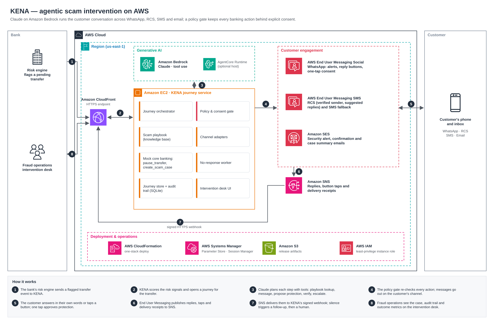

# KENA — Knowledge-Enabled Notification Agent

**An agentic scam-intervention service for retail banks.** When a customer is about to send money to a scammer, KENA steps in on the customer's own messaging app, finds out what is really happening, and, with the customer's one-tap consent, pauses the transfer before the money leaves.

Built for the **AWS CDS Agentic AI Partner Hackathon 2026** by team **Scamurais** (HCLTech).

▶ **Demo video (3 min):** https://www.youtube.com/watch?v=Y_YrtHfkRxg

## Try KENA

KENA has a web front end with two views: the bank's **intervention desk** at `/`, and a **customer phone** at `/device` that plays the customer's WhatsApp, RCS or SMS app. You don't need a phone number or email address to try it; the customer phone is where you act as the customer.

- **Hosted demo:** use the deployed URL in the submission's "Try it out" links. No sign-in is needed; it runs on AWS Lambda behind Amazon CloudFront with AWS WAF.
- **Run it yourself:** about five minutes with Python 3.12+ and no AWS account; see [Run locally](#run-locally-no-aws) below.

Then:

1. Open the intervention desk, and the customer phone in a second window (**Customer device ↗** in the sidebar).
2. On the desk choose **WhatsApp**, tick **Active call**, enter `8000` and click **Create transfer**. The alert appears on the phone.
3. On the phone, tap **No, not me**, or type a reply such as "a police officer told me to move my savings to a safe account".
4. Tap **Pause & open case**. The desk shows the transfer paused, the scam case, the email record and the audit trail.
5. Try another transfer and tap **Yes, I made it**, or create an **RCS** transfer and leave it unanswered: after the follow-up delay (90 seconds by default) KENA follows up on another channel and escalates to a human.

Free-text replies are understood by Claude on Amazon Bedrock when `KENA_AGENT=claude` is set with AWS credentials. Without AWS, KENA uses its built-in rules agent, which understands the reply buttons and explicit phrases such as "I did not make this transfer".

## The problem

Most scam losses are authorised push payments: the victim makes the transfer themselves, often while a "police officer" or "bank officer" is still on the phone telling them what to do. Banks can flag these payments, but the intervention is usually a static SMS warning that coached victims ignore, or a call-back that comes too late.

## What KENA does

1. **Detect.** The bank's risk engine sends a flagged transfer (for example S$8,000 to a new payee during an active phone call). KENA scores the signals and opens a journey for it.
2. **Reach out.** KENA messages the customer at once on **WhatsApp, RCS or SMS**, with one-tap answers, and sends a security-alert **email** through Amazon SES.
3. **Converse.** The customer answers in their own words. **Claude on Amazon Bedrock** reads the reply with the full context, looks up KENA's scam playbook (government or bank impersonation, investment, job, romance, e-commerce and coached-transfer scams), and decides what to do next.
4. **Act, with consent.** If the transfer looks like a scam, KENA sends a fixed consent message with a **Pause & open case** button. One tap pauses the transfer and opens a scam-review case, atomically and with a full audit trail. A typed "yes" never authorises anything.
5. **Follow up and close.** If the customer goes quiet, the agent follows up on another channel and then hands the case to a fraud specialist. Every journey ends with an email that carries the whole cross-channel conversation, and the bank sees response rate and time to protect on a live dashboard.

**Demo scope.** In the recorded demo, Claude on Amazon Bedrock and Amazon SES run live. WhatsApp and RCS messages go through the same journey code but are shown on KENA's customer-device emulator, because WhatsApp Business onboarding and RCS agent registration were not complete in time. The AWS End User Messaging adapters for WhatsApp, RCS and SMS and the SNS inbound webhook are implemented and contract-tested; switching a channel to live is configuration (`KENA_LIVE_CHANNELS`). All customer, payee and banking data is synthetic and banking actions are mocked.

**Built with:** Amazon Bedrock (Claude, tool use) · AWS End User Messaging Social (WhatsApp) · AWS End User Messaging SMS (RCS, SMS) · Amazon SES · Amazon SNS · optional Amazon Bedrock AgentCore Runtime · Amazon EC2 · Amazon CloudFront · AWS CloudFormation · AWS Systems Manager · Amazon S3 · AWS IAM · Python / FastAPI.

## What the agent decides, and what it can't

| Claude decides (tool use) | The server enforces |
| --- | --- |
| What to say, in the customer's language | No links, phone numbers, credential requests or promises of refunds (`app/policy.py`) |
| Which scam typology fits (`search_scam_playbook`) | Only `pause_transfer` and `create_scam_case` exist, and only after consent |
| When to ask for protection (`propose_protection`) | Consent wording is fixed server text; only the WhatsApp/app button carries consent, never a typed "yes" |
| When the customer is genuine (`record_customer_verified`) | Five-minute consent bound to customer, transfer, proposal and policy version |
| When to escalate (`escalate_to_human`) and which channel to follow up on | Amount cap, transfer state and channel availability re-checked before anything is committed |

Every action is planned against a snapshot, re-validated against the current state, and committed atomically with the audit trail and outbox.

## Architecture



Deployed with `infra/kena.yaml`: EC2 behind a CloudFront HTTPS URL, an SNS topic for channel events, and IAM limited to WhatsApp, SMS, SES, Bedrock and its own config. See [architecture](docs/architecture.md).

## Run locally (no AWS)

Python 3.12+.

```bash
git clone https://github.com/ojunhao/KENA.git kena && cd kena
python -m venv .venv && source .venv/bin/activate     # Windows: .\.venv\Scripts\Activate.ps1
python -m pip install -r requirements.txt
python -m app.run                                     # http://127.0.0.1:8000
```

Open the customer phone emulator at http://127.0.0.1:8000/device (or **Customer device ↗** in the sidebar) next to the dashboard. It renders WhatsApp, RCS (Google Messages) or SMS, and its buttons and composer act as the customer.

1. Choose **WhatsApp**, keep **New payee**, tick **Active call**, and click **Create transfer** (S$8,000 scores 90).
2. Click **Not my transfer** or type your own reply. KENA proposes protection; the transfer is still pending.
3. Click **Confirm pause & open case**. The transfer pauses atomically, a case opens, and WhatsApp and SES confirmations appear in the outbox.
4. Leave another transfer unanswered: after 90 seconds (`KENA_NO_RESPONSE_SECONDS`) KENA follows up on another channel, then escalates to a human with an email record.

To use Claude while keeping channels simulated: `AWS_REGION=ap-southeast-1 python -m app.run --agent claude` (needs AWS credentials and Bedrock model access).

## Go live

**From your laptop:** follow **[docs/setup-local-live.md](docs/setup-local-live.md)**. Claude on Bedrock and SES run live from your AWS account; `KENA_LIVE_CHANNELS=SES` sends WhatsApp, RCS and SMS to the device emulator through the same code path. `python scripts/connect_local.py check` verifies the setup. Any channel can be switched to live once its registration is done.

**Hosted on AWS, serverless:** `python scripts/deploy_lambda.py --password '...'` deploys KENA as an AWS Lambda function behind Amazon CloudFront with AWS WAF (rate limiting and AWS managed rule sets), with journey state in Amazon DynamoDB. It uses no EC2, VPC, public IP or security group, so it suits locked-down landing-zone accounts. Channels are emulated (the `/device` page plays the customer) and Claude on Bedrock is live. See [docs/setup-aws.md](docs/setup-aws.md#serverless-deployment-lambda--cloudfront--waf).

**Hosted on AWS, EC2:** follow **[docs/setup-aws.md](docs/setup-aws.md)**, then one command creates an EC2 + CloudFront stack with live WhatsApp:

```bash
python scripts/deploy_aws.py --phone +6591234567 --email you@example.com --ses-sender you@example.com \
  --wa-phone-number-id phone-number-id-... --waba-id waba-... --password '...'
```

## Configuration

| Variable | Purpose |
| --- | --- |
| `KENA_LIVE=1` | Send through AWS. Without it every channel is simulated. |
| `KENA_LIVE_CHANNELS` | Optional subset sent through AWS, e.g. `SES`; the rest go to the `/device` emulator |
| `KENA_ALERT_EMAIL` | `1` (default) also emails the customer when a transfer is flagged |
| `KENA_AGENT` | `local` (default), `claude` (Bedrock), or `agentcore` (with `KENA_AGENTCORE_RUNTIME_ARN`) |
| `KENA_MODEL`, `KENA_EFFORT` | Bedrock model ID (default `anthropic.claude-opus-5-5`) and optional effort level |
| `KENA_CUSTOMER_PHONE`, `KENA_CUSTOMER_EMAIL`, `KENA_CUSTOMER_NAME` | The demo customer's real contact details; inbound messages are matched on the phone number |
| `KENA_WA_PHONE_NUMBER_ID`, `KENA_WA_TEMPLATE` | WhatsApp origination number and optional approved template |
| `KENA_SMS_IDENTITY`, `KENA_RCS_IDENTITY`, `KENA_SES_SENDER` | Other channels; unset channels are simply unavailable to the agent |
| `KENA_SNS_TOPIC_ARN` | Only signed SNS messages from this topic are accepted at `/webhooks/sns` |
| `KENA_BASIC_AUTH` | `user:password` for the dashboard; required on a public interface |
| `KENA_NO_RESPONSE_SECONDS`, `KENA_DB` | Follow-up delay and SQLite path |

See `.env.example`.

## Tests

```bash
python -m pytest -q                        # 115 tests; AWS calls are stubbed, no network
python scripts/verify_local.py --browser   # isolated server + CLI demo + Chromium checks (Node 22+, npm install)
```

Coverage includes the original journey, consent, concurrency and deletion invariants, plus WhatsApp payload contracts (text, interactive buttons, templates), SNS signature verification and subscription, inbound replies and button taps, stale or replayed consent, delivery receipts, WhatsApp-to-SMS failover, no-response follow-up and escalation, Claude's tool loop with policy feedback and refusal handling, agent text screening and dashboard authentication.

## Modules

| Component | Responsibility |
| --- | --- |
| `app/service.py` | Journey state machine, two-phase agent planning, consent, atomic mock actions, outbox, receipts, failover, no-response orchestration |
| `app/agent.py` | Risk rules, Claude on Bedrock tool loop (`ClaudeAgent`), deterministic `LocalAgent` fallback |
| `app/policy.py` | Action authorisation and screening of agent-written text |
| `app/playbook.py` | Scam typology knowledge the agent retrieves |
| `app/messaging.py` | WhatsApp (End User Messaging Social), SMS/RCS, SES adapters and the simulator |
| `app/inbound.py` | SNS signature verification; WhatsApp and two-way SMS event parsing |
| `app/main.py`, `app/run.py`, `app/config.py` | HTTP API, webhook, background worker, dashboard auth, environment settings |
| `app/agentcore.py` | Optional Bedrock AgentCore Runtime client and entrypoint |
| `app/static/` | Intervention desk (dashboard) and the customer-device emulator (`/device`) |
| `scripts/connect_local.py` | Wires your AWS account to a laptop-hosted KENA: readiness check, test email, SNS topic, WhatsApp events, tunnel subscription |
| `infra/kena.yaml`, `scripts/deploy_aws.py` | EC2 + CloudFront CloudFormation stack and deploy script |
| `app/lambda_handler.py`, `app/dynamo_store.py`, `scripts/deploy_lambda.py` | Serverless hosting: Lambda entry point, DynamoDB journey store, Lambda + CloudFront + WAF deploy script |

## Boundaries

- Banking tools are mocked; KENA never executes, releases, refunds or reverses funds, and verification leaves funds pending for review.
- Inbound identity is "message came from the enrolled phone number", which is fine for a demo, not for production. Real deployments need authenticated in-app consent.
- `X-Demo-Customer` on the web simulator is an identity assertion, not authentication. Protect any public deployment with `KENA_BASIC_AUTH`.
- Conversation text is stored in SQLite. Don't enter real customer data or secrets.
- A provider's "accepted" isn't "delivered"; KENA shows delivered/read only when WhatsApp reports it. Failed sends are re-routed once to SMS when configured, never blindly retried.
- Risk scores, the S$100,000 cap and the five-minute consent window are demo choices, not regulatory requirements.

## Team

Scamurais, HCLTech, for the AWS CDS Agentic AI Partner Hackathon 2026.

## License

[MIT](LICENSE)
