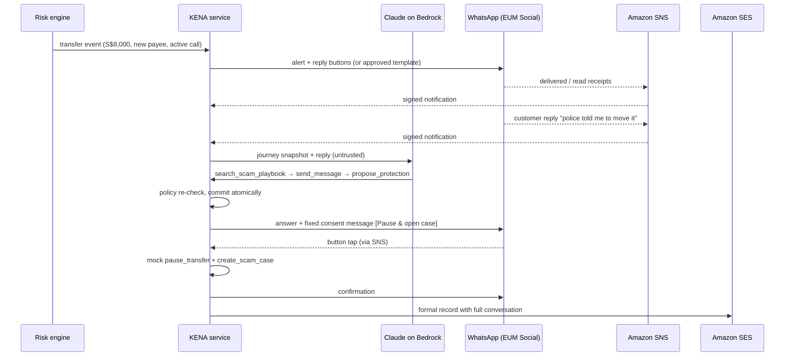

# Technical architecture

A vector version is in [architecture.svg](architecture.svg), and an editable one in [architecture.drawio](architecture.drawio) (open it at app.diagrams.net or in draw.io desktop).

## Journey

If the customer doesn't answer within `KENA_NO_RESPONSE_SECONDS`, the background worker asks the agent for a decision with trigger `no_response`; it can follow up on another configured channel or escalate to a human with an email record. If a WhatsApp send fails, or WhatsApp later reports it failed (for example outside the 24-hour window), the message is re-sent once by SMS when SMS is configured.

## Components

| Concern | Implementation |
| --- | --- |
| HTTP, dashboard, webhook | FastAPI (`app/main.py`), static frontend, `/webhooks/sns` |
| Journey state | SQLite aggregate per transfer, `BEGIN IMMEDIATE` serialised writes (`app/store.py`) |
| Agent | `ClaudeAgent`: Messages API on Bedrock through `AnthropicBedrockMantle`, bounded tool loop (five turns, three messages); `LocalAgent` rules fallback; optional AgentCore Runtime adapter |
| Knowledge | `app/playbook.py` scam typologies (government/bank impersonation, investment, job, romance, e-commerce, coached transfer) |
| Authority | `app/policy.py` evaluates every action against current state and screens agent-written text |
| Channels | `app/messaging.py`: `socialmessaging.send_whatsapp_message` (text, interactive reply buttons, templates), `pinpoint-sms-voice-v2.send_text_message`, `sesv2.send_email` |
| Inbound | `app/inbound.py`: SNS signature v1/v2 verification against Amazon's certificate, topic pinning, auto-confirmed subscription, WhatsApp webhook entries and two-way SMS parsing |
| Hosting | `infra/kena.yaml`: Ubuntu EC2 (SSM-managed, IMDSv2), CloudFront HTTPS, SNS topic with End User Messaging publish policy, SSM Parameter for config, least-privilege role |

## Decision flow and invariants

Agent calls take seconds, so a reply is handled in three phases:

1. Record the inbound message and take a snapshot, in one transaction.
2. Let the agent plan against the snapshot, outside the database lock. Its tool results come from the same policy function the server uses, so Claude gets immediate feedback (`credential_request_not_allowed`, `amount_exceeds_protection_cap`, `channel_unavailable`, …) and can adapt.
3. Re-validate each planned action against the current state and commit actions, audit and outbox atomically. Then dispatch.

Invariants carried over from the MVP, all covered by tests:

1. A risk event cannot execute banking tools.
2. Agent output cannot authorise banking tools. Consent is a separate structured operation: the web confirmation or a WhatsApp button whose ID references the current proposal by hash. The token itself never leaves the server.
3. Confirmation must match the latest unexpired proposal for the same transfer and customer and approve both allow-listed actions.
4. Verification never releases funds.
5. Pause and case creation are atomic, one case per journey, also under concurrent or duplicated deliveries (SNS retries are idempotent through message-ID command keys).
6. Communication failure leaves completed protection intact and auditable.
7. Without `KENA_LIVE=1` nothing is sent to AWS.

## Known limits

- One process and SQLite on one instance. A production design would move state to DynamoDB with conditional writes and dispatch through an SQS outbox worker.
- Sends happen synchronously after commit; a crash in between leaves queued messages, which are recovered on startup only for the simulator.
- Inbound identity is the enrolled phone number. Production needs authenticated app consent and per-customer enrolment.
- WhatsApp receipts are matched on the provider message ID returned by `SendWhatsAppMessage`. Unmatched receipts are ignored.
