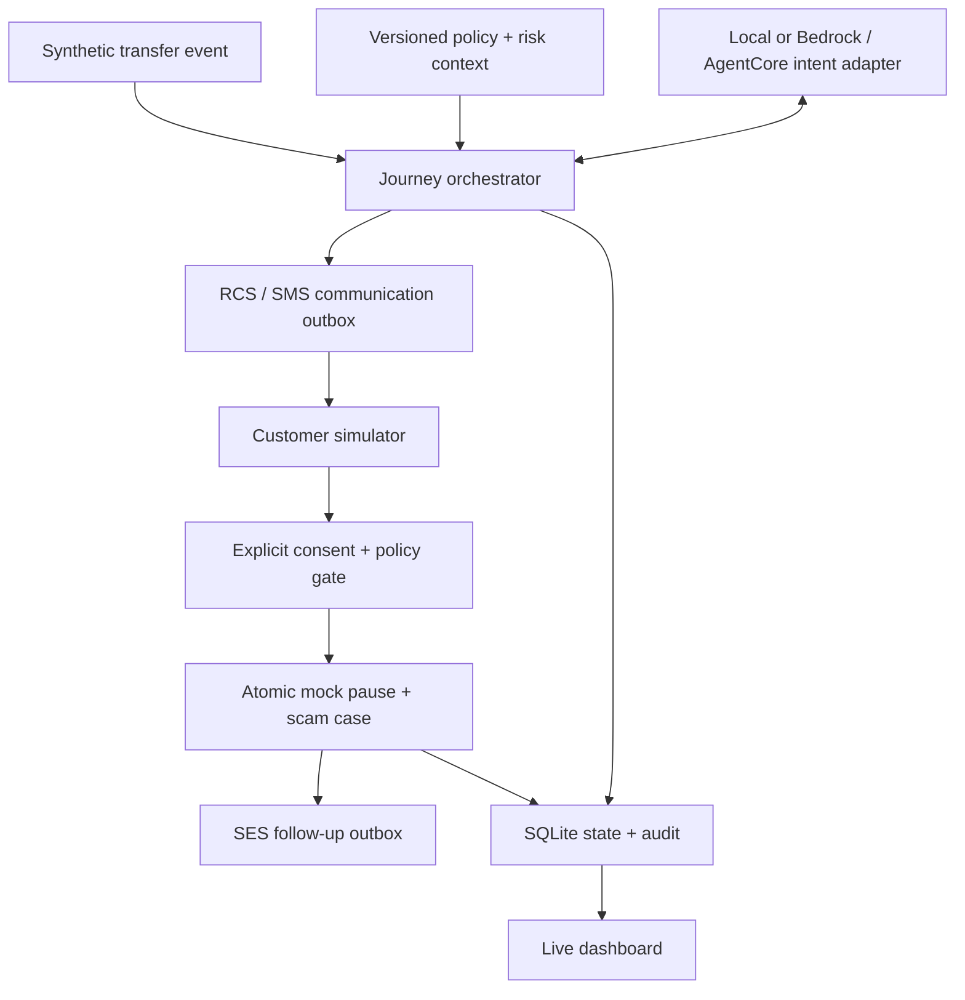

# Technical architecture

## Local implementation

One FastAPI process serves the responsive frontend and JSON API. A synthetic transaction event enters a deterministic risk assessment. The journey orchestrator retrieves versioned policy and context, initiates an RCS/SMS outbox message, and interprets customer responses through a replaceable agent interface. Agent output is restricted to intent suggestions. All customer-facing text and banking authorization remain server-controlled.

The service retrieves journey context on every reply. A disputed transfer receives a proposed action; confirmation is a separate structured operation, not model-generated authority. The mock banking tools, case record and outbox commit in one SQLite transaction. `BEGIN IMMEDIATE` serializes concurrent changes; unique event IDs and command fingerprints suppress duplicate transitions. Operator views omit consent tokens. Customer views require the matching synthetic customer assertion.

## Planned AWS deployment

| Local module | AWS transition | Status |
| --- | --- | --- |
| Event ingestion | EventBridge → SQS → orchestrator | Not provisioned |
| FastAPI + frontend | ECS/Fargate or another approved container host behind authenticated HTTPS | Docker scaffold only |
| Reply intent adapter | Bedrock Converse, optionally hosted on AgentCore Runtime | SDK adapters and runtime entrypoint provided; stub-tested, not deployed |
| Journey / policy store | DynamoDB conditional writes, versioned policy and TTL | SQLite implemented; cloud store pending |
| Communications | AWS End User Messaging RCS/SMS + SES | SDK adapters stub-tested; no live wiring |
| Inbound replies | Supported two-way messaging notifications → SNS/Lambda → trusted customer/session mapping | Pending |
| Consent | Trusted banking app confirmation or authenticated rich action callback | Demo simulator only |
| Outbox | Durable SQS worker, bounded retry and receipt reconciliation | In-process simulated dispatch only |
| Audit | CloudWatch/OpenTelemetry + durable restricted audit records | Local JSON audit only |

CDS owns outreach and follow-up, not merely a final notification. In cloud mode, reply events and channel receipts must be correlated with an existing journey. An inbound phone number alone is not a trusted identity; protective tools require a separately authenticated consent flow. No raw public SNS endpoint is provided in this MVP.

AgentCore currently hosts the replaceable decision adapter; the FastAPI service owns the state machine and authorization. Moving broader orchestration into AgentCore is a subsequent integration milestone, not an already completed deployment.

For approved live RCS, start with an appropriately registered agent and test device. This adapter uses direct identity selection. Direct RCS sends have no automatic SMS fallback; pool-based sending can provide fallback when appropriately configured. Add configuration sets/event destinations and correlate receipts before displaying delivered status. Rich RCS cards/actions require a separate richer message contract; the local confirmation button is not a live RCS card.

## Invariants and failure handling

1. A risk event cannot execute banking tools.
2. An agent suggestion cannot authorize banking tools.
3. Confirmation must match the latest unexpired proposal for the same transaction/customer and approve both allow-listed actions.
4. Customer verification never releases funds; risk remains subject to bank review.
5. Case creation and mock pause are atomic, one case per journey, including concurrent confirmation replays.
6. Communication failure leaves completed protection intact and auditable.
7. Default local execution cannot invoke AWS.

The SQLite transaction/outbox provides local durability, not a distributed transaction with real banks or delivery providers. A process crash between commit and dispatch can leave queued messages; application startup recovers queued messages only for the side-effect-free simulator. Failed sends are never automatically retried. Real-bank integration needs independently idempotent tools and a resumable workflow with partial-failure reconciliation. Live transport dispatch must be moved outside the database transaction into an asynchronous worker before cloud integration.

## Assumptions

The mock bank has a pending-transfer state that can still be paused. KENA does not recover an already settled transfer. Risk scores and thresholds are demonstration assumptions, not a trained or calibrated fraud model. The S$100,000 cap and five-minute consent lifetime are demo policy choices, not regulatory requirements. SES closure is simulated and describes protection accurately without promising recovery.

## Official integration references

- [AWS End User Messaging: Sending RCS messages](https://docs.aws.amazon.com/sms-voice/latest/userguide/rcs-send-message.html)
- [Bedrock Converse inference](https://docs.aws.amazon.com/bedrock/latest/userguide/conversation-inference.html)
- [AgentCore HTTP protocol contract](https://docs.aws.amazon.com/bedrock-agentcore/latest/devguide/runtime-http-protocol-contract.html)
- [AgentCore runtime getting started](https://docs.aws.amazon.com/bedrock-agentcore/latest/devguide/runtime-get-started-cli.html)

Checked against official AWS documentation during development on 13 October 2026. Service availability, registration and regional prerequisites must be verified in the approved target account before provisioning.
